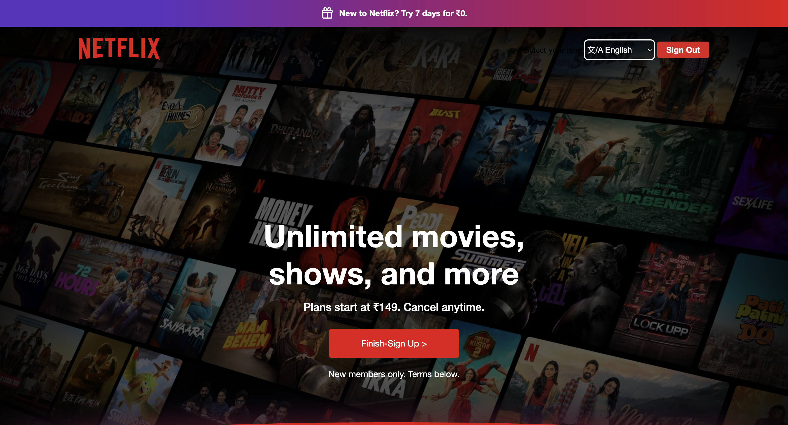
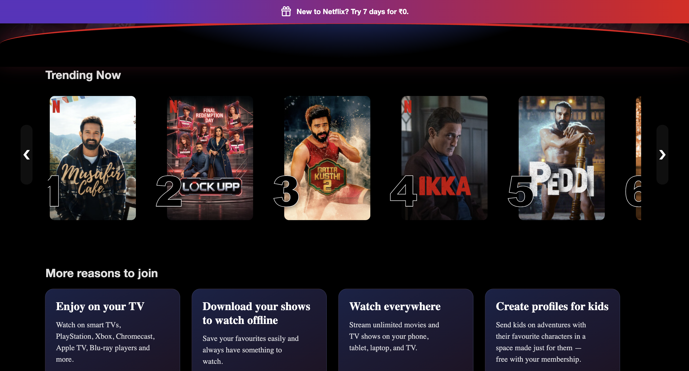
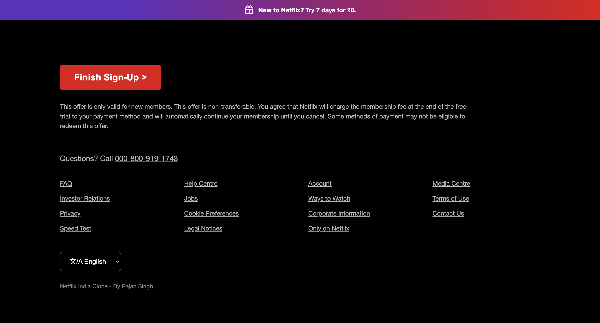

# Netflix Homepage Clone

A responsive **Netflix Homepage Clone** built using **HTML, CSS, and JavaScript**.
This project recreates the look and feel of the Netflix landing page with modern UI effects, smooth interactions, and responsive sections.

---

## Features

* Fixed top offer banner
* Responsive navigation bar
* Hero section with background image and dark overlay
* Netflix-style curved separator with red/blue glow
* Trending movies carousel
* Left/right scroll buttons
* Hover zoom effect on movie cards
* Top 10 ranking numbers on cards
* “More Reasons to Join” feature cards
* Netflix-style footer section
* Mobile-friendly responsive layout

---

## Technologies Used

* **HTML5**
* **CSS3**
* **JavaScript (Vanilla JS)**

---

## Project Structure

```text
netflix-clone/
│── index.html
│── style.css
│── script.js
│── assets/
│   ├── images/
│   └── icons/
└── README.md
```

---

## Getting Started

### 1. Clone the repository

```bash
git clone https://github.com/YOUR_USERNAME/netflix-clone.git
```

### 2. Open the project folder

```bash
cd netflix-clone
```

### 3. Run the project

Open **index.html** in your browser.

---

## Live Demo

Add your deployed link here after publishing:

```text
https://rajansingh018.github.io/netflix-clone/
```

---

## Screenshots

## Screenshots

### login Section


### Trending Section


### Footer


---

## What I Learned

While building this project, I practiced:

* CSS Flexbox and layout design
* Positioning and layering with `z-index`
* Gradients and overlay effects
* Hover animations and transitions
* Horizontal scrolling with JavaScript
* Responsive web design
* Organizing frontend project structure

---

## Future Improvements

* Add movie details modal
* Integrate a real movie API (TMDB)
* Add authentication pages
* Improve mobile navigation
* Add dark/light theme toggle

---

## Author

**Rajan Singh**
B.Tech (IT) Student | Aspiring AI & ML Engineer

GitHub: https://github.com/rajansingh018


---

## License

This project is created for **educational and portfolio purposes only**. Netflix is a trademark of Netflix, Inc.
